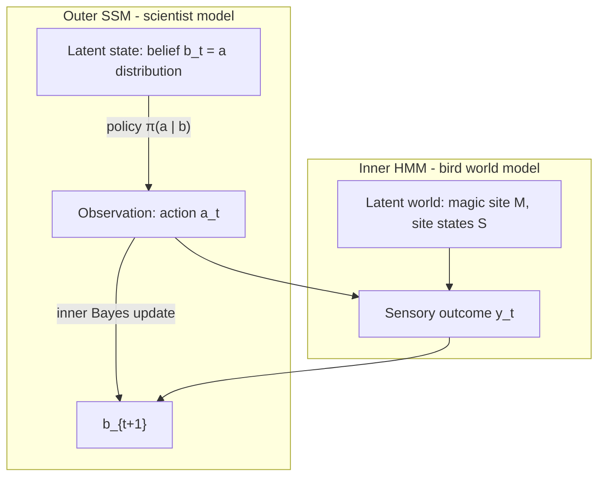

# Bayesian State-Space Model of Bird Caching Behavior

Design document for a nested Bayesian model of birds foraging and caching in a circular arena with a Magic Site. Intended as a basis for a JAX implementation.

**Out of scope for this draft:** dataframe schema, session parsing, parameter estimation, and hierarchical multi-bird models.

---

## 1. Goal and experimental setup

### Arena

- There are $N = 32$ **sites**, indexed $i \in \{0, \ldots, 31\}$, laid out on a **circle**.
- Each site has a binary **site state** (seed presence): $S_i \in \{0, 1\}$.
- Circular topology matters for movement cost / locality (circular distance $d(i,j) = \min\{|i-j|,\, N - |i-j|\}$).

### Behavior

At each discrete event, the bird:

1. **Interacts** with the current site: $u \in \{\mathrm{cache},\, \mathrm{retrieve},\, \mathrm{check}\}$.
2. **Relocates** to a (possibly new) site: $r \in \{0, \ldots, 31\}$.

Time is discretized so that each index $t$ corresponds to one interaction-plus-relocation cycle.

### Magic Site

In each experimental session, one site $M^\star \in \{0, \ldots, 31\}$ is the **Magic Site**. It refills automatically after a period of time. Other sites may refill with lower probability.

After enough exposure, birds typically identify the Magic Site and return to it frequently.

### Modeling target

The primary latent object is the bird’s **belief** $b_t$ over Magic Site location (and seed states). Birds that have identified the Magic Site should exhibit a **low-entropy** Magic-Site marginal $p_t(M)$. From the scientist’s point of view, inferring that latent means maintaining uncertainty over which belief the bird holds—a posterior over distributions.

---

## 2. Nested model architecture

The model has two layers, from two different agents’ perspectives:

1. **Outer state-space model (SSM) — the scientist’s model of the bird.** The latent state is the bird’s **belief** $b_t$, which is itself a probability distribution. Observations are the bird’s actions.
2. **Inner HMM — the bird’s model of the world.** Belief updates are exact Bayesian filtering under this HMM; the output of that filter *is* the outer latent $b_t$.

### Latent state is a distribution

This nesting is easy to misread, so state it explicitly:

- In the **inner** model, the bird has uncertainty over world variables $(M, S)$. Its belief $b_t = p_t(M,S)$ (or a structured approximation) is a distribution on that world.
- In the **outer** model, that belief $b_t$ is the **latent state**. So the scientist’s prior/posterior over $b_t$ is a **distribution over distributions** (a law on the belief simplex / structured belief manifold).
- The scientific target “low-entropy Magic Site belief” is a property of the latent $b_t$ (e.g. small $H[p_t(M)]$), not of the scientist’s posterior over $b_t$.

| Layer | Role |
| --- | --- |
| Outer hidden state | Belief $b_t$ — a **distribution** over the bird’s latent world $(M,S)$ |
| Outer posterior (scientist) | A distribution over possible $b_t$’s (distribution over distributions) |
| Outer observation | Action $a_t = (u_t, r_t)$ |
| Outer observation model | Policy $\pi(a_t \mid b_t)$ |
| Outer transition | Belief update $b_{t+1} = U(b_t, a_t, y_t)$ from the inner filter |
| Inner latents | Magic site $M$, site states $S$ |
| Inner emission / outcome | Sensory outcome $y_t$ of the interaction |

**Important:** the outer transition is (approximately) **deterministic** given $(b_t, a_t, y_t)$, because $U$ is an exact Bayes update. Stochasticity of behavior lives primarily in the policy $\pi$.

**Implication for outer inference:** if $y_{1:T}$ (and parameters / $b_0$) are treated as known, the belief path $b_{1:T}$ is a deterministic function of $b_0$ and the data, so the scientist’s posterior over trajectories can collapse to uncertainty only in $b_0$ and/or $\theta$. Nontrivial posterior mass over many belief paths requires uncertainty in $y$, $b_0$, $\theta$, or a stochastic belief transition. This is flagged again in design decision 7.

---

## 3. Notation and state spaces

### Sites and topology

| Symbol | Meaning |
| --- | --- |
| $N = 32$ | Number of sites |
| $i, j, r \in \{0,\ldots,N-1\}$ | Site indices |
| $d(i,j)$ | Circular distance |

### True world (for simulation; may differ from the bird’s model)

| Symbol | Meaning |
| --- | --- |
| $M^\star$ | True Magic Site (fixed within a session) |
| $S^\star_t \in \{0,1\}^N$ | True seed presence vector |
| Refill process | True dynamics of $S^\star$ (Magic Site schedule + weaker refill elsewhere) |

### Bird’s latent world (inner HMM)

| Symbol | Meaning |
| --- | --- |
| $M$ | Magic Site location (categorical over $N$ sites) |
| $S \in \{0,1\}^N$ | Seed presence under the bird’s model |
| $b_t$ | Bird’s belief: a distribution $b_t = p_t(M, S)$ (or structured approx.); **outer latent** |
| Scientist posterior | Law over possible $b_t$ (distribution over distributions) |
### Actions and sensory outcomes

| Symbol | Meaning |
| --- | --- |
| $u_t \in \{\mathrm{cache},\, \mathrm{retrieve},\, \mathrm{check}\}$ | Interaction type |
| $r_t \in \{0,\ldots,N-1\}$ | Relocation / site visited at step $t$ (site of interaction) |
| $a_t = (u_t, r_t)$ | Full action (outer observation) |
| $y_t$ | Sensory outcome at the interacted site (see design decisions) |

**Default lean (open):** $y_t \in \{0,1\}$ is whether a seed is present/observed at the interacted site under interaction $u_t$.

### Belief summaries

| Symbol | Meaning |
| --- | --- |
| $p_t(M)$ | Marginal belief over Magic Site |
| $H[p_t(M)]$ | Entropy of Magic Site belief (primary learning readout) |
| $p_t(S_i \mid M)$ or $p_t(S_i)$ | Site-wise seed beliefs (under factorization) |

---

## 4. Inner HMM (bird’s world model)

The inner model defines how the bird thinks the world works and how actions and outcomes update $b_t$. We intend **exact** filtering under a structured factorization.

### Generative pieces to specify

1. **Prior**
   - $p(M)$: default lean = uniform over $N$ sites at session start.
   - $p(S \mid M)$: how seed presence depends on which site is magic (e.g. Magic Site more likely to contain a seed; other sites sparse / independent).

2. **Dynamics** $p(S_{t+1} \mid S_t, M, a_t)$
   - Depletion from retrieve (and possibly from other interactions).
   - Refill: Magic Site refills on a timer or with high probability; non-magic sites refill with lower probability.
   - The bird’s dynamics may be **misspecified** relative to the true apparatus.

3. **Outcome likelihood** $p(y_t \mid S_{r_t}, u_t)$
   - What each interaction reveals about $S_{r_t}$.
   - Default lean: check is observe-only; retrieve observes and clears if present; cache observes and/or sets seed present (see design decisions).

4. **Action-conditioned state change**
   - Deterministic or stochastic edits to $S$ given $u_t$ (cache sets, retrieve clears, check no-op).

### Exact inference and structure

A fully joint discrete state $(M, S)$ has size $N \cdot 2^N = 32 \cdot 2^{32}$, which is intractable.

**Default lean:** factor through the Magic Site,

$$
p_t(M, S) \approx p_t(M)\, \prod_{i=0}^{N-1} p_t(S_i \mid M),
$$

with site beliefs coupled **only through** $M$. Then the filter maintains:

- a categorical distribution over $M$ ($N$ weights), and
- for each hypothesized $m$, $N$ Bernoulli parameters $p(S_i=1 \mid M=m)$,

i.e. $N + N^2 = 32 + 1024$ scalars—tractable and JAX-friendly.

Updates proceed by:

1. predict $S$ forward under each hypothesized $M=m$ (refill / depletion),
2. update site $r_t$ (and $p(M)$) from likelihood $p(y_t \mid S_{r_t}, u_t)$,
3. apply any deterministic action effects on $S_{r_t}$.

---

## 5. Outer SSM (policy and belief transition)

### State and observation

- Hidden state: $b_t$, the bird’s structured belief (a point in a space of distributions). The scientist’s Bayesian posterior over this state is therefore a distribution over distributions.
- Observation: $a_t = (u_t, r_t)$.

### Observation model = policy

$$
a_t \sim \pi(\,\cdot \mid b_t;\, \theta_\pi)
$$

The policy maps beliefs to a distribution over interaction type and next/current site. Natural ingredients:

- **Value of sites** under $p_t(M)$ and $p_t(S_i \mid M)$ (e.g. expected seed, information gain about $M$, Magic-Site revisit value).
- **Movement kernel** on the circle (local bias / travel cost using $d(\cdot,\cdot)$).
- **Exploration** (Boltzmann temperature, $\varepsilon$-greedy, etc.).
- Optional factorization: choose site $r_t$ then interaction $u_t$, or a joint categorical over $(u,r)$.

### Transition model = inner Bayes update

$$
b_{t+1} = U(b_t, a_t, y_t;\, \theta_{\mathrm{inner}})
$$

where $U$ is the exact filter step under the inner HMM parameters $\theta_{\mathrm{inner}}$.

### Sensory outcomes in the outer likelihood

Behavior data may record actions $a_{1:T}$ while the bird also conditions on $y_{1:T}$. For a generative story we must decide whether $y_t$ is:

- known from the apparatus (treated as observed covariates when evaluating $\pi$ and $U$),
- latent and marginalized,
- or reconstructed from recorded site states.

This draft defines $y_t$ in the generative model but does not commit to a fitting likelihood. See design decision 7.

### Joint generative story (one step)

1. Bird holds belief $b_t$.
2. Sample action $a_t \sim \pi(\cdot \mid b_t)$.
3. True (or simulated) world produces outcome $y_t$ and updates $S^\star$.
4. Bird updates $b_{t+1} = U(b_t, a_t, y_t)$.

---

## 6. Success criterion

**Primary:** the bird has identified the Magic Site when the Magic-Site marginal is low-entropy:

$$
H[p_t(M)] = -\sum_{m=0}^{N-1} p_t(M=m)\,\log p_t(M=m)
$$

is small (near $0$ for a delta belief; $\log N$ for uniform).

In simulation, an optional oracle diagnostic is high posterior mass on the truth: $p_t(M = M^\star)$.

**Secondary behavioral diagnostics** (not the latent definition): return frequency to $M^\star$, check→retrieve patterns, dwell / revisit structure on the circle.

---

## 7. Key design decisions

Each item blocks or shapes implementation. Default leans are proposals, not commitments.

### 1. Belief factorization

- **Options:** fully joint $p(M,S)$; mean-field $p(M)\prod_i p(S_i)$; structured $p(M)\prod_i p(S_i\mid M)$.
- **Default lean:** $p(M)\prod_i p(S_i\mid M)$—sites couple only through the Magic Site hypothesis.
- **Why it matters:** determines filter state size and whether Magic-Site evidence can coordinate site beliefs.

### 2. What is $y_t$?

- **Options:** binary seed presence at interacted site; interaction-specific observation channels; include refill timing cues; noisy observation.
- **Default lean:** $y_t \in \{0,1\}$ = seed observed at site $r_t$ given $u_t$, with interaction-dependent likelihood / noise later if needed.
- **Why it matters:** defines the inner emission model and what must be available when running $U$.

### 3. Effect of actions on $S$

- **Options / lean:**
  - **check:** observe $S_{r_t}$; do not change $S$.
  - **retrieve:** observe; if seed present, set $S_{r_t} \leftarrow 0$ (and deliver reward in the policy’s utility).
  - **cache:** set $S_{r_t} \leftarrow 1$ (possibly only if empty; observation of prior state TBD).
- **Why it matters:** determines predict/update order inside $U$ and legal action effects.

### 4. Refill process in the bird’s model

- **Options:** known deterministic timer for Magic Site; geometric / Bernoulli refill each step; continuous-time waiting mapped into event time; misspecified vs matched to apparatus.
- **Default lean:** event-time Bernoulli refill with rate $\rho_{\mathrm{magic}}$ when $i=M$ and $\rho_{\mathrm{other}} \ll \rho_{\mathrm{magic}}$ otherwise (simple, exact-filter friendly). Refine toward timer semantics if experiments demand it.
- **Why it matters:** drives how $p(S_i\mid M)$ evolves between visits and how $M$ is identified.

### 5. Policy family

- **Options:** myopic expected reward; information-gain / active learning about $M$; Boltzmann over Q-values; habit / stickiness; separate “where” vs “what” heads.
- **Default lean:** myopic utility = expected seed recovery + bonus for visiting high-$p(M)$ sites, with Boltzmann temperature $\tau$; add circular movement cost. Information-gain terms optional later.
- **Why it matters:** defines $\pi(a\mid b)$ and thus the outer observation model.

### 6. Movement support

- **Options:** any site reachable each step; soft local kernel $\propto e^{-\beta\, d(r_{\mathrm{prev}}, r)}$; hard adjacent-only moves.
- **Default lean:** all sites allowed, with soft circular distance penalty in the policy logits.
- **Why it matters:** shapes spatial trajectories and identifiability of belief from movement alone.

### 7. Is $y_t$ part of the outer observation?

- **Options:** $(a_t, y_t)$ both observed when scoring trajectories; only $a_t$ observed and $y_t$ latent; $y_t$ reconstructed from logged apparatus state.
- **Default lean for now:** define the generative model with $y_t$; when fitting later, prefer treating apparatus-known seed outcomes as observed covariates so $U$ stays deterministic given data.
- **Why it matters:** outer likelihood and whether belief trajectories are uniquely determined by recorded behavior.

### 8. Parameters: free vs fixed

| Candidate | Role | Lean |
| --- | --- | --- |
| $\rho_{\mathrm{magic}}, \rho_{\mathrm{other}}$ | Refill rates in inner model | Free or set from experiment |
| Prior $p(M)$, initial $p(S_i\mid M)$ | Session start beliefs | Fixed uniform / simple defaults |
| Policy temperature $\tau$, distance penalty $\beta$ | Exploration / movement | Free |
| Reward weights (seed vs Magic revisit vs info) | Policy utilities | Free / staged |
| Observation noise | $p(y\mid S,u)$ | Fixed ideal for v1 |

### 9. Initialization and session boundaries

- **Default lean:** each session resets $p(M)$ to uniform; initialize $p(S_i=1\mid M=m)$ higher for $i=m$ than for $i\neq m$; clear or carry habit parameters only if the policy has explicit sticky state (prefer stateless policy in v1).
- **Why it matters:** entropy trajectories and cross-session learning.

### 10. JAX implementation sketch

Target v1 shapes (factored belief):

- `log_p_M`: `(N,)`
- `p_S_given_M`: `(N, N)` with `[m, i] = P(S_i=1 | M=m)`
- `action`: `(u, r)` enums / ints
- `y`: scalar bool/float

Pure functions:

- `predict(belief, params) -> belief`
- `update(belief, a, y, params) -> belief`
- `policy_logits(belief, prev_r, params) -> logits over (u, r)`
- `step` composed inside `lax.scan` over event time

Simulated readout: plot $H[p_t(M)]$ and $p_t(M=M^\star)$ over $t$.

---

## 8. Out of scope (this draft)

- Mapping to dataframe columns / session parsing.
- Parameter estimation (MLE, EM, MCMC, variational methods).
- Hierarchical models across birds.
- Continuous-time refill clocks except as later refinement of decision 4.

---

## 9. Next steps

1. Resolve design decisions 1–9 (accept defaults or revise).
2. Implement a thin JAX prototype:
   - factored inner filter (`predict` / `update`),
   - toy Boltzmann policy with circular distance penalty,
   - simulated Magic Site world,
   - trajectory + entropy of $p_t(M)$ diagnostic plot.
3. Only then align abstract $(a_t, y_t)$ with recorded data fields.
